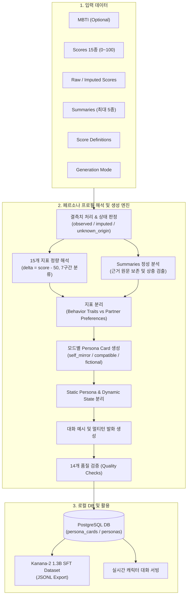

# [기획서] Kanana-2 1.3B SFT 연계 AI 캐릭터 페르소나 시스템 & 로컬 DB 적재 설계서

---

## 1. 개요 및 목적

### 1.1 배경
- 본 프로젝트는 사용자의 온보딩 설문 및 대화 데이터를 기반으로 개인화된 AI 캐릭터 대화 경험을 제공하는 시스템을 구축하고 있습니다.
- 향후 온디바이스 및 프라이빗 서빙을 위해 경량 SLM인 **Kanana-2 1.3B** 모델을 활용한 **Persona-conditioned Multi-Turn SFT(지도 미세조정)** 및 실시간 캐릭터 대화 시스템을 도입하고자 합니다.
- 이를 위해서는 단순 점수 데이터의 나열을 넘어, 정량적 수치(15개 지표)와 정성적 요약(최대 5개 summaries), MBTI를 정밀하게 해석하여 일관된 말투, 행동 규칙, 갈등 해결 전략, 동적 대화 상태를 포함하는 **구조화된 AI 캐릭터 Persona Card**를 생성하고 로컬 DB에 안정적으로 적재하는 기반 시스템이 필수적입니다.

### 1.2 목적
1. **정밀 해석(Interpretation)**: 관측 점수(`observed`), 결측 대체 점수(`imputed`), 미확정 점수(`unknown_origin`)를 엄격히 분리하여 데이터의 정보량을 과장하지 않고 해석.
2. **구별 가능한 캐릭터 정의**: 3가지 모드(`self_mirror`, `compatible_character`, `fictional_variant`)에 맞추어 실제 대화에서 차별화되는 고유의 행동 규칙과 발화 스타일 구축.
3. **로컬 DB 적재 및 학습 연계**: 정의된 페르소나 카드와 대화 예시를 로컬 PostgreSQL DB에 체계적으로 적재하고, Kanana-2 1.3B 훈련용 JSONL 데이터셋으로 즉시 변환 가능한 파이프라인 구축.

---

## 2. 시스템 아키텍처 및 파이프라인



---

## 3. 로컬 DB 모델링 및 스키마 설계

### 3.1 저장 전략
기존 서비스 테이블(`personas`, `onboarding_sessions`)과의 호환성을 고려하면서, 새로 정의된 Persona Card 전체 스펙을 엄밀하게 유지하기 위해 신규 전용 테이블 `persona_cards`를 설계합니다.

### 3.2 SQLAlchemy ORM 모델 명세 (`persona_cards`)

```python
class PersonaCardRecord(Base):
    __tablename__ = "persona_cards"

    id: Mapped[str] = mapped_column(String(32), primary_key=True, default=_uuid)
    persona_id: Mapped[str] = mapped_column(String(64), unique=True, index=True) # e.g. character_001
    user_id: Mapped[str] = mapped_column(String(64), index=True) # e.g. synth_user_intj_01
    name: Mapped[str] = mapped_column(String(50))
    generation_mode: Mapped[str] = mapped_column(String(32)) # self_mirror | compatible_character | fictional_variant
    mbti_reference: Mapped[str | None] = mapped_column(String(4))

    # 15개 지표 세부 해석 객체 (raw_score, effective_score, delta, level, status, interpretation)
    traits: Mapped[dict] = mapped_column(JSONBCompat, nullable=False)
    
    # 결측치 관리 배열
    imputed_scores: Mapped[list] = mapped_column(JSONBCompat, default=list)
    unknown_origin_scores: Mapped[list] = mapped_column(JSONBCompat, default=list)
    available_summaries: Mapped[list] = mapped_column(JSONBCompat, default=list)
    missing_summaries: Mapped[list] = mapped_column(JSONBCompat, default=list)

    # 행동 및 선호 지표 분류
    behavior_traits: Mapped[dict] = mapped_column(JSONBCompat, nullable=False)
    partner_preferences: Mapped[dict] = mapped_column(JSONBCompat, nullable=False)

    # 대화 및 관계 스타일
    communication_style: Mapped[dict] = mapped_column(JSONBCompat, nullable=False)
    conflict_style: Mapped[dict] = mapped_column(JSONBCompat, nullable=False)
    relationship_style: Mapped[dict] = mapped_column(JSONBCompat, nullable=False)

    # 근거 기반 행동 규칙
    personality_rules: Mapped[list] = mapped_column(JSONBCompat, nullable=False)

    # 동적 대화 상태
    dynamic_state: Mapped[dict] = mapped_column(JSONBCompat, nullable=False)

    # Kanana-2 SFT용 멀티턴 대화 예시
    dialogue_examples: Mapped[list] = mapped_column(JSONBCompat, default=list)

    # 검증 및 부가 메타데이터
    evidence: Mapped[list] = mapped_column(JSONBCompat, default=list)
    creative_elements: Mapped[list] = mapped_column(JSONBCompat, default=list)
    conflicts: Mapped[list] = mapped_column(JSONBCompat, default=list)
    quality_checks: Mapped[dict] = mapped_column(JSONBCompat, nullable=False)

    created_at: Mapped[datetime] = mapped_column(DateTime(timezone=True), default=_now)
```

---

## 4. 수치 지표 및 결측치 해석 규칙

### 4.1 기준값 및 강도 구간 분류
모든 지표는 0~100 정수 범위이며, 중간 기준값은 50입니다.
$$\Delta = \text{effective\_score} - 50$$

| 점수 범위 | 분류 | 행동 반영 원칙 |
| :---: | :---: | :--- |
| **0 ~ 24** | **매우 낮음** | 낮은 방향의 특성이 뚜렷함 |
| **25 ~ 39** | **낮음** | 낮은 방향의 특성이 나타남 |
| **40 ~ 49** | **약간 낮음** | 약한 경향으로 반영 |
| **50** | **중립** | 특정 방향으로 치우치지 않음 |
| **51 ~ 60** | **약간 높음** | 약한 경향으로 반영 |
| **61 ~ 75** | **높음** | 높은 방향의 특성이 나타남 |
| **76 ~ 100** | **매우 높음** | 높은 방향의 특성이 뚜렷함 |

> [!IMPORTANT]
> 본 구간은 임상적 진단이 아닌 캐릭터 대화 행동 규칙 생성을 위한 휴리스틱이며, 50점에서 멀어질수록 특성이 두드러지나 행동 강도가 점수에 선형 비례한다고 가정하지 않습니다.

### 4.2 결측치 처리 및 관측 상태 3분류
1. **`observed` (실제 관측)**:
   - 원본 `raw_scores`가 존재하거나 결측 목록에 포함되지 않은 유효 점수.
   - 캐릭터 성격 및 행동 규칙의 직접적 근거로 활용 가능.
2. **`imputed` (대체값)**:
   - 원본값이 결측되어 50점으로 대체된 지표.
   - 평균적 기본 행동을 구성하되 강한 성향의 근거로 사용하지 않음.
3. **`unknown_origin` (출처 불명 50점)**:
   - 원본 정보 없이 점수 50만 존재하는 경우. 관측값인지 대체값인지 확정할 수 없으므로 평균 수준으로만 처리.

### 4.3 15개 지표의 역할 분리
- **Behavior Traits (본인 성격 반영)**: `anxiety`, `avoidance`, `assurances`, `compliance`, `contact_rhythm`, `disclosure`, `engagement`, `openness`, `positivity`, `problem_solving`, `withdrawal`, `seriousness`
  - *예외 정책*: `assurances` 지표는 관측 데이터가 확보되지 않은 경우 대체된 50점만으로 안심·확신 행동을 과잉 생성하지 않습니다.
- **Partner Preferences (상대 선호도)**: `ideal_status`, `ideal_vitality`, `ideal_warmth`
  - 본인 성격으로 전이하지 않으며, `compatible_character` 모드에서 상대 캐릭터의 목표 프로필로만 활용합니다.

---

## 5. 요약 텍스트 정성 분석 및 정합성 검증

### 5.1 요약 데이터 수집 조건
- 5개 카테고리: `communication`, `conflict`, `intimacy`, `ideal`, `orientation`
- 존재하는 카테고리만 `available_summaries`에 등록하고, 부재하거나 비어 있는 카테고리는 `missing_summaries`로 명확히 분리합니다.
- 없는 요약의 내용을 임의로 지어내지 않습니다.

### 5.2 점수와 요약 간 상충(`conflicts`) 처리
- 관측된 수치 점수와 요약 텍스트의 방향이 상충하는 경우(예: withdrawal이 80인데 요약에는 '갈등 시 즉시 풀기를 원함'), 강제로 한쪽을 덮어쓰지 않고 `conflicts` 필드에 기록하여 페르소나의 복합적/조건부 행동(예: '초기에는 침묵하나 상대가 먼저 다가오면 즉시 대화')으로 구체화합니다.

---

## 6. 캐릭터 생성 모드 (Generation Mode)

| 모드 | 목적 | 행동 특성 반영 방식 | 창작 허용 범위 |
| :--- | :--- | :--- | :--- |
| **`self_mirror`** | 사용자 본인 성향 충실 재현 | 관측된 Behavior Traits와 요약 100% 반영 | 최소화 (관측 불가 영역의 기본 예의만) |
| **`compatible_character`** | 사용자 선호에 부합하는 상호보완 파트너 | 사용자의 Partner Preferences + 상호작용 조화 설계 | 성격 톤 및 관심사, 대화 주도성 등 중간 수준 |
| **`fictional_variant`** | 성향 기반 오리지널 매력 캐릭터 | 핵심 지표 방향성 유지, 개성 극대화 | 이름, 직업, 세계관, 대화 습관, 유머 스타일 적극 창작 |

---

## 7. Static Persona vs Dynamic State

### 7.1 Static Persona (불변 원칙)
- 캐릭터의 핵심 가치관, 기본 화법(존댓말/반말, 문장 길이), 갈등 대처 기본 전략, 근거 기반 행동 규칙(`personality_rules`).

### 7.2 Dynamic State (대화 중 가변 상태)
- 대화 턴의 흐름에 따라 변동되는 런타임 상태.
- 초기값:
  - `current_mood`: "neutral"
  - `closeness`: 50 (친밀도, 0~100)
  - `trust`: 50 (신뢰도, 0~100)
  - `current_context`: null
- *주의*: closeness와 trust의 초기값 50은 런타임 상태의 중간 기준점이며, 사용자 성향 점수의 평균 50과는 독립된 상태값입니다.

---

## 8. Kanana-2 1.3B SFT 연계 및 데이터셋 구축 전략

### 8.1 SFT 훈련 프롬프트 포맷 (Persona-Conditioned Format)
Kanana-2 1.3B 모델이 페르소나 조건을 준수하며 자연스럽게 발화할 수 있도록 아래 구조의 프롬프트-응답 쌍을 구성합니다.

```text
[SYSTEM]
당신은 다음 페르소나를 지닌 AI 캐릭터입니다. 주어진 성격과 행동 규칙, 상태를 준수하여 대화하세요.
- 이름: {{name}} ({{mbti_reference}})
- 말투: {{communication_style.speech_level}}, 문장길이: {{communication_style.sentence_length}}, 감정표현: {{communication_style.emotional_expression}}
- 핵심 행동 규칙:
  1. {{personality_rules[0].rule}}
  2. {{personality_rules[1].rule}}
- 갈등 대처: {{conflict_style.primary_strategy}}
- 현재 상태: 기분={{dynamic_state.current_mood}}, 친밀도={{dynamic_state.closeness}}, 신뢰도={{dynamic_state.trust}}

[CONTEXT / HISTORY]
상대방: {{user_message_history}}

[CURRENT_TURN]
상대방: {{current_user_message}}
{{name}}: {{assistant_response}}
```

### 8.2 대표 시드 페르소나 유저 셋 (Diversity Matrix)
로컬 DB에 등록하여 학습 및 검증에 활용할 4개 대표 군집 페르소나:

1. **군집 1: 논리·신중형 (INTJ '서윤', self_mirror)**
   - 지표 특징: 높은 problem_solving(78), 낮은 disclosure(30), 높은 anxiety(65), avoidance(50, imputed)
   - 발화 특성: 반말/짧은 문장, 감정 배제 및 원인 분석 중심, 신중한 거리두기.
2. **군집 2: 공감·표현형 (ENFP '지우', fictional_variant)**
   - 지표 특징: 높은 positivity(85), 높은 disclosure(80), 높은 engagement(75)
   - 발화 특성: 존댓말+친근한 어조, 이모지 및 리액션 풍부, 적극적인 호감 표현.
3. **군집 3: 경계·독립형 (ISTP '도현', self_mirror)**
   - 지표 특징: 높은 avoidance(82), 높은 withdrawal(75), 낮은 contact_rhythm(25)
   - 발화 특성: 매우 건조하고 간결한 단문, 감정적 요구에 한 템포 물러서는 반응.
4. **군집 4: 따뜻한 지지형 (ISFJ '하은', compatible_character)**
   - 지표 특징: 사용자의 ideal_warmth(88), ideal_vitality(60)에 맞춘 배려 중심 캐릭터
   - 발화 특성: 다정한 존댓말, 상대 감정을 먼저 살피는 질문, 갈등 시 경청 우선.

---

## 9. 14개 품질 검증 체크리스트 (Quality Checks)

출력 및 DB 적재 전 반드시 다음 14개 항목을 자동 검증합니다.
1. 모든 유효 점수가 0~100 범위인가?
2. 50이 평균 기준값으로 일관되게 사용되었는가?
3. 결측 수치가 50으로 대체되었는가?
4. 관측값(`observed`)과 대체값(`imputed`)이 구분되었는가?
5. 원본 정보가 없는데 관측 여부를 임의로 확정하지 않았는가? (`unknown_origin` 기록 여부)
6. 15개 수치 지표가 traits에 누락 없이 모두 포함되었는가?
7. 존재하는 summaries만 분석되었는가?
8. 없는 summaries 내용을 지어내지 않았는가?
9. ideal 지표(상대 선호도)가 본인 성격과 엄격히 분리되었는가?
10. MBTI만으로 성격을 단정하지 않았는가?
11. 행동 규칙에 데이터 근거(`evidence_source`) 또는 창작 여부(`creative`)가 표시되었는가?
12. 동일 점수에서도 다양한 표현 스타일이 가능한가?
13. Static Persona와 Dynamic State가 분리되었는가?
14. JSON 스키마 및 DB 모델의 타입 제약조건을 만족하는가?

---

## 10. 단계별 구현 로드맵

- [ ] **Step 1: DB 모델 정의 및 마이그레이션 스크립트 작성**
  - `app/features/persona/models.py`에 `PersonaCardRecord` 추가 또는 독립 마이그레이션 생성
- [ ] **Step 2: Persona Card 생성 엔진 (`card_generator.py`) 구현**
  - 15개 지표 해석, 결측치 분리, 룰 생성, 품질 검사 로직 작성
- [ ] **Step 3: 시드 페르소나 데이터 생성 및 로컬 DB 적재 CLI (`scripts/generate_ai_persona_users.py`) 작성**
  - INTJ '서윤'을 포함한 대표 유저 프로필 자동 생성 및 DB 커밋
- [ ] **Step 4: 로컬 DB 적재 검증 및 SFT JSONL 익스포터 구현**
  - DB 조회 테스트 및 Kanana-2 1.3B 훈련용 멀티턴 포맷 변환 확인
